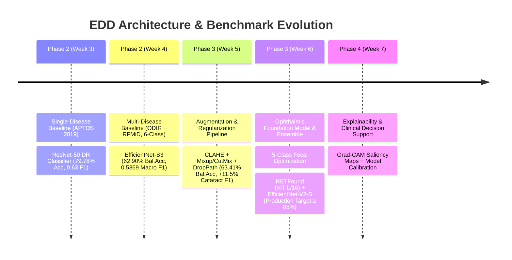

# 👁️ Eye Disease Detection (EDD) — Production-Grade Retinal Screening System

An advanced deep learning framework for automated, multi-disease screening from retinal fundus photography. EDD transitions from classical transfer learning baselines to domain-specific ophthalmic foundation models (**RETFound**) combined with modern CNN architectures (**EfficientNet-V2**) to achieve clinical-grade classification accuracy.

---

## 📌 Executive Summary

Early detection of vision-threatening retinal diseases—such as Diabetic Retinopathy, Glaucoma, Cataracts, and Age-related Macular Degeneration (AMD)—is essential to prevent irreversible visual impairment. However, widespread clinical screening is constrained by specialist availability and high-volume manual grading workloads.

**EDD** addresses this challenge through an end-to-end multi-dataset pipeline that:
- Harmonizes heterogeneous clinical datasets (**ODIR-5K**, **RFMiD 2.0**, **APTOS 2019**, and **Eye Diseases Classification**).
- Applies ophthalmology-tailored image preprocessing (**CLAHE**, sensor variance normalization, and artifact simulation).
- Leverages the **RETFound** foundation model (*Nature 2023*, pretrained on 1.6M retinal images) via two-phase fine-tuning.
- Deploys a **hybrid ensemble** combining global transformer representations (RETFound ViT-L/16) with local texture features (EfficientNet-V2-S).

---

## 🎯 Target Clinical Classes

The system evaluates color fundus photographs across 5 primary diagnostic categories:

| Class | Clinical Description | Key Retinal Biomarkers |
| :--- | :--- | :--- |
| **Normal** | Healthy retina | Clear optic disc margins, normal cup-to-disc ratio (CDR), intact macula and vascular arcade. |
| **Diabetic Retinopathy (DR)** | Microvascular retinal disease | Microaneurysms, intraretinal hemorrhages, hard/soft exudates, neovascularization. |
| **Glaucoma** | Optic nerve neuropathy | Increased cup-to-disc ratio (CDR > 0.6), neuroretinal rim thinning, optic disc cupping, RNFL defects. |
| **Cataract** | Crystalline lens opacification | Diffuse blurring, hazy retinal view, reduced vessel contrast, diminished red reflex. |
| **AMD** | Age-related macular degradation | Drusen (hard/soft), retinal pigment epithelium (RPE) changes, geographic atrophy, choroidal neovascularization. |

*(Note: Phase 2/3 early iterations benchmarked a 6-class setup with an ambiguous "Other" catch-all class. Production architectures isolate the 5 actionable conditions to maximize clinical specificity and diagnostic precision).*

---

## 📊 Performance & Roadmap Progression

```
+-----------------------------------------------------------------------------------------+
|                                    ACCURACY PROGRESSION                                 |
+-----------------------------------------------------------------------------------------+
| Phase 2 Week 4 (EfficientNet-B3 Baseline, 6-class)     : 62.90% Bal.Acc | 0.5369 Macro F1|
| Phase 3 Week 5 (+ CLAHE, Mixup/CutMix, DropPath)       : 63.41% Bal.Acc | 0.5324 Macro F1|
|                                                          (+11.47% Cataract F1 boost)    |
| Phase 3 Week 6 (RETFound ViT-L + EfficientNet-V2-S)    : ≥ 85.0% Target | ≥ 0.80 Macro F1|
+-----------------------------------------------------------------------------------------+
```

### Detailed Evolution



---

## 🏗️ System Architecture

```
                          [ Color Fundus Photograph ]
                                       │
                      ┌────────────────┴────────────────┐
                      ▼                                 ▼
             [ Preprocessing ]                 [ Preprocessing ]
             - CLAHE (Tile 8x8)                - CLAHE (Tile 8x8)
             - Sensor Normalization            - Resize 288x288
             - Resize 224x224                  - Light Mixup / Soft CE
                      │                                 │
                      ▼                                 ▼
         ┌────────────────────────┐        ┌─────────────────────────┐
         │     Model A: RETFound   │        │ Model B: EfficientNet-V2│
         │   (ViT-Large/16, 307M) │        │     (CNN Backbone)      │
         │  Pretrained on 1.6M CFP│        │   High-Res Local Textures│
         └───────────┬────────────┘        └────────────┬────────────┘
                     │ Softmax Probabilities            │ Softmax Probabilities
                     │ (Weight: 0.65)                   │ (Weight: 0.35)
                     └────────────────┬─────────────────┘
                                      ▼
                        [ Weighted Softmax Ensemble ]
                                      │
                                      ▼
                        [ Class-Calibrated Prediction ]
                     (Normal / DR / Glaucoma / Cataract / AMD)
```

### Key Technical Highlights
1. **RETFound Foundation Transfer**: Adapts the 307M parameter Vision Transformer (`vit_large_patch16_224`) pretrained on 1.6M retinal fundus photos. Fine-tuned with:
   - **Phase A (Linear Probe)**: 5 epochs, frozen backbone, head learning rate $1 \times 10^{-3}$.
   - **Phase B (Full Fine-Tune)**: 30 epochs with layer-wise learning rate decay ($1.0\times$ head, $0.1\times$ top-4 blocks, $0.01\times$ early blocks).
   - **Gradient Checkpointing & AMP**: Memory optimization enabling ViT-Large execution within 16 GB VRAM on standard Kaggle T4 GPUs.
2. **Medical Augmentation**: Custom Albumentations pipeline including Contrast Limited Adaptive Histogram Equalization (CLAHE) for vessel arborization enhancement, sensor temperature shifts, and CoarseDropout for artifact simulation.
3. **Loss Function**: Weighted Focal Loss ($\gamma = 2.0$) with inverse class-frequency balancing to eliminate bias against minority pathologies.

---

## 📁 Repository Structure

```
d:/Projects/EDD/
├── README.md                      # Complete project documentation
├── KAGGLE_GUIDE_PHASE2_WEEK4.md   # Setup guide for Phase 2 Week 4 baseline
├── KAGGLE_GUIDE_PHASE3_WEEK5.md   # Setup guide for Phase 3 Week 5 augmentations
├── HUGGINGFACE_KAGGLE_SETUP.md    # Guide for Hugging Face authentication & RETFound
├── edd_phase2_week4.ipynb         # Notebook: Baseline multi-disease classifier
├── edd_phase3_week5.ipynb         # Notebook: Regularization & augmentation pipeline
├── edd_phase3_week6.ipynb         # Notebook: RETFound fine-tuning & ensemble
├── kaggle_phase2_week4.py         # Standalone pipeline: Phase 2 Week 4
├── kaggle_phase3_week5.py         # Standalone pipeline: Phase 3 Week 5
├── kaggle_phase3_week6.py         # Standalone pipeline: Phase 3 Week 6
├── generate_week6_notebook.py     # Automated builder script for Week 6 notebook
├── stats.txt                      # Baseline test set evaluation log
├── datasets.xlsx                  # Dataset inventory & label schema mapping
├── roadmap.xlsx                   # Multi-phase project delivery timeline
├── models/                        # Serialized checkpoints (.pth)
├── eval_results/                  # Confusion matrices, ROC curves, and reports
└── data/                          # Local metadata and dataset staging
```

---

## 🚀 Getting Started

### Prerequisites

- Python 3.10+
- PyTorch 2.2+ (with CUDA support)
- Hugging Face account (with access to [RETFound](https://huggingface.co/YukunZhou/RETFound_mae_natureCFP))

Install dependencies:
```bash
pip install torch torchvision --index-url https://download.pytorch.org/whl/cu121
pip install timm albumentations opencv-python-headless huggingface_hub safetensors pandas scikit-learn matplotlib seaborn
```

### Running on Kaggle (Recommended)

1. **Hardware**: Create a Kaggle Notebook and configure **Accelerator: GPU T4 x2** (or GPU P100).
2. **Internet Access**: Turn **Internet: ON** in notebook settings.
3. **Secrets Setup**:
   - Go to **Add-ons → Secrets**.
   - Create secret `HF_TOKEN` with your Hugging Face read access token.
4. **Attach Datasets**:
   - `andrewmvd/ocular-disease-recognition-odir5k`
   - `andrewmvd/retinal-disease-classification`
   - `aptos2019-blindness-detection`
   - `gunavenkatdoddi/eye-diseases-classification`
5. **Execute Notebook**:
   Import and run `edd_phase3_week6.ipynb` sequentially from Cell 1 through Cell 17.

### Running Locally / On Staging Server

Run the complete Phase 3 Week 6 training pipeline:
```bash
# Set your Hugging Face token
export HF_TOKEN="hf_your_access_token_here"  # Linux/macOS
$env:HF_TOKEN="hf_your_access_token_here"     # Windows PowerShell

# Run the training pipeline
python kaggle_phase3_week6.py
```

---

## 📈 Evaluation Outputs & Artifacts

Upon completion of training, the pipeline generates the following assets under `results/`:
- `summary_metrics.json`: Final accuracy, balanced accuracy, and macro F1 scores.
- `confusion_matrix.png`: Normalized multi-class confusion matrix.
- `retfound_curves.png`: Training loss and validation balanced accuracy progression.
- `retfound_best.pth`: Best checkpoint state dictionary with metadata.
- `effnet_best.pth`: EfficientNet-V2-S checkpoint state dictionary.

---

## ⚖️ Clinical Disclaimer & Ethics

This software is developed strictly for research, academic evaluation, and preliminary screening prototyping. It is not an FDA-cleared or CE-marked medical device and must not be used as a standalone diagnostic instrument without validation by certified ophthalmologists and qualified medical personnel.
