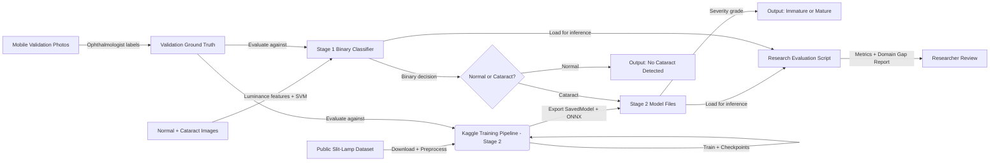

# Architecture Overview — EDD v2

## Modules & Responsibilities
- `Kaggle Training Pipeline` (Python notebooks): Owns dataset download, preprocessing, model training, checkpointing, evaluation, and model export for Stage 2 (EfficientNet-B0 severity grader). Does not touch mobile validation photos directly.
- `Stage 1 Binary Classifier` (Luminance + SVM): Owns normal vs cataract detection. Implements paper's luminance feature extraction (median filter + watershed + mean luminance) + SVM with Gaussian kernel. Lightweight, no GPU needed.
- `Stage 2 Severity Grader` (EfficientNet-B0): Owns immature vs mature classification for diseased eyes only. Receives input only when Stage 1 detects cataract.
- `Mobile Validation Set` (collected photos + ophthalmologist labels): Owns ground-truth labels for mobile-captured eye photos. Write-only during collection; read-only during evaluation. Does not influence training.
- `Exported Model` (TensorFlow SavedModel + ONNX): Owns the trained Stage 2 model in research-friendly formats. Read-only by evaluation scripts.
- `Stage 1 Model` (SVM pickle + luminance parameters): Owns the trained Stage 1 binary classifier. Read-only by evaluation scripts.

## Trust Boundaries & Data Entry
- Untrusted Input Points:
  - Mobile camera/gallery image files (arbitrary resolution, lighting, quality) — used only for validation, never training.
  - Public training dataset labels (trusted source but potentially noisy severity labels).
- Internal Boundaries:
  - Stage 1 (Luminance + SVM) -> binary decision (normal/cataract)
  - Stage 2 (EfficientNet-B0) -> severity grade (immature/mature) — only invoked if Stage 1 = cataract
  - Training pipeline (trusted, local/Kaggle) -> exported SavedModel/ONNX -> Evaluation script (research-only).

## System Map

## Links
- `docs/DECISIONS.md` — Recorded architectural decisions (D-001 through D-009).
- `docs/FLOW.md` — Step-by-step execution traces for training and evaluation.
- `docs/DATA.md` — Data schemas and access patterns.
- `docs/PLAN.md` — Overall project plan, timeline, and risks.
