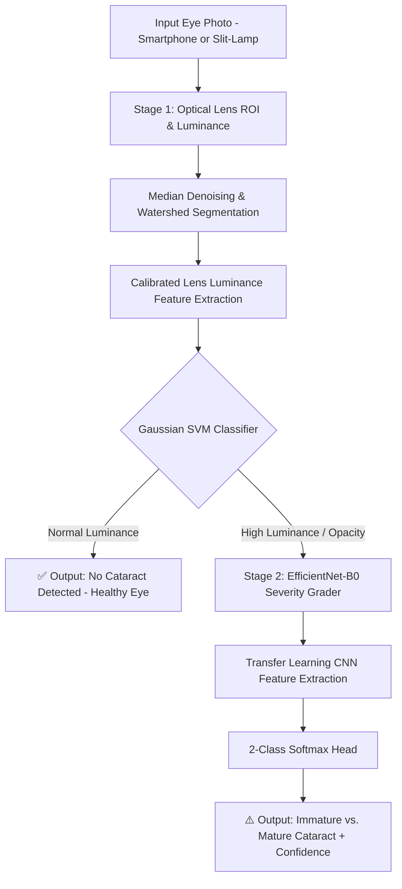

# 👁️ EDD v2 — Early Cataract Detection & Severity Grading from Smartphone Photography

[](https://www.python.org/)
[](https://tensorflow.org/)
[](https://streamlit.io/)
[](LICENSE)

An explainable, two-stage computer vision system designed for **rural and primary healthcare screening**. It detects cataracts and grades disease severity directly from **standard smartphone photos**, overcoming the severe optical domain gap between professional slit-lamp biomicroscopes and consumer mobile cameras.

---

## 📌 Table of Contents
- [The Problem & Domain Gap](#-the-problem--the-domain-gap)
- [Two-Stage Hybrid Architecture](#-two-stage-hybrid-architecture)
- [Empirical Benchmarks & Real-World Results](#-empirical-benchmarks--real-world-results)
- [Visual Explainability (ROI & Grad-CAM)](#-visual-explainability-roi--grad-cam)
- [Project Structure](#-project-structure)
- [Installation & Setup](#-installation--setup)
- [Usage & Running](#-usage--running)
- [Key Research Insights](#-key-research-insights)
- [Documentation Index](#-documentation-index)

---

## 🏥 The Problem & The Domain Gap

Cataracts account for more than **50% of global blindness**, predominantly affecting rural and underserved populations where ophthalmologists and ophthalmic slit-lamp biomicroscopes are unavailable.

While deep learning models achieve high accuracy on curated research datasets, those datasets rely almost exclusively on **slit-lamp imaging**:
- **Slit-Lamp Modality:** Controlled darkroom, pharmacologically dilated pupils (mydriasis), focused slit beams, uniform high-end optics.
- **Smartphone Camera Reality:** Ambient room lighting, undilated/constricted pupils, specular flash glare on the cornea, variable focal distance, and sensor noise.

> **Research Finding:** A standard end-to-end convolutional neural network (EfficientNet-B0) trained on slit-lamp data collapsed to **41.2% accuracy** and missed **87.5% of cataracts** on real smartphone photos. EDD v2 was built to solve this domain gap.

---

## 🔬 Two-Stage Hybrid Architecture

To overcome shortcut learning and domain shift, EDD v2 decouples **optical detection** from **deep feature grading**:



### 1. Stage 1 — Optical Lens Luminance + Gaussian SVM
*Based on peer-reviewed methodology by Askarian et al. (IEEE JTEHM, 2021).*
- **Median Blur:** Removes high-frequency corneal noise and salt-and-pepper sensor artifacts.
- **Watershed Segmentation:** Isolates the crystalline lens aperture (pupil ROI) from eyelids, sclera, and skin.
- **Optical Luminance Calculation:**
  $$BV = 0.299 \cdot R + 0.587 \cdot G + 0.114 \cdot B$$
  $$\text{Luminance} = \frac{2^{BV}}{0.0929} \quad (\text{calibrated for mobile aperture optical density})$$
- **Classifier:** Support Vector Machine (RBF/Gaussian kernel) trained on 790 benchmark eyes (normal benchmark mean: `14.66`, diseased benchmark mean: `15.65`).
- **Gating Mechanism:** Healthy eyes exit early as *Normal*, avoiding false-positive escalations.

### 2. Stage 2 — Severity Grader (EfficientNet-B0)
- **Model:** EfficientNet-B0 (5.3M parameters).
- **Architecture Choice:** Downscaled from EfficientNet-B7 (64M parameters), which had suffered from catastrophic feature collapse on small datasets (~410 images) with 0.0% recall on mature cases. EfficientNet-B0 resolved this with balanced multi-class convergence.
- **Role:** Invoked **only** when Stage 1 confirms lens opacification to distinguish **Immature Cataract** from **Mature Cataract**.

---

## 📊 Empirical Benchmarks & Real-World Results

### Real Smartphone Eye Photos Trial ($N = 17$ total: 9 Normal + 8 Cataract)
Evaluated on unconstrained smartphone photos captured via mobile camera ([`data/real_photos_test/`](file:///d:/Projects/EDD/v2/data/real_photos_test)):

| Model / Architecture | Overall Accuracy | Sensitivity (Cataract Recall) | Specificity (Normal Recall) | Precision | F1-Score |
| :--- | :---: | :---: | :---: | :---: | :---: |
| **Stage 1 (Luminance + SVM)** | **88.2%** (15/17) | **87.5%** (7/8) | **88.9%** (8/9) | **87.5%** | **87.5%** |
| **Two-Stage Pipeline (Stage 1 $\rightarrow$ Stage 2)** | **88.2%** (15/17) | **87.5%** (7/8) | **88.9%** (8/9) | **87.5%** | **87.5%** |
| **Direct Binary CNN (EfficientNet-B0)** | **41.2%** (7/17) | **12.5%** (1/8) | **66.7%** (6/9) | **25.0%** | **16.7%** |

### Benchmark Hold-Out Datasets (Clinical / Slit-Lamp)
- **Stage 1 SVM on Slit-Lamp/External Set ($N = 790$):** **78.7%** Accuracy, 72.7% Sensitivity, 85.3% Specificity, ROC-AUC: 80.3%.
- **Stage 2 EfficientNet-B0 on Slit-Lamp Hold-Out ($N = 81$):** **59.3%** Accuracy, 64.1% Mature Recall, 54.8% Immature Recall, ROC-AUC: 60.1%.

---

## 🔍 Visual Explainability (ROI & Grad-CAM)

Medical AI requires trust and verification. EDD v2 incorporates dual explainability mechanisms:
1. **Lens ROI Segmentation Masks:** Saves green-overlay watershed segmentations demonstrating exactly which ocular aperture area was analyzed for luminance.
2. **Grad-CAM Attention Heatmaps:** Generates activation overlays from the final convolutional layer (`top_conv`) of the EfficientNet-B0 backbone to verify whether the model is focusing on nuclear lens cloudiness or distracted by corneal flash reflections and eyelids.

*Output directories: [`results/real_photos_test/roi_masks/`](file:///d:/Projects/EDD/v2/results/real_photos_test/roi_masks) and [`results/real_photos_test/gradcam/`](file:///d:/Projects/EDD/v2/results/real_photos_test/gradcam)*.

---

## 📁 Project Structure

```text
EDD/v2/
├── app.py                           # Interactive Streamlit Web Application
├── requirements.txt                 # Python dependencies
├── docs/                            # Research documentation and specifications
│   ├── ARCHITECTURE.md              # System design & module boundaries
│   ├── DECISIONS.md                 # Architecture Decision Records (ADRs D-001 to D-009)
│   ├── FLOW.md                      # Detailed end-to-end execution traces
│   ├── DATA.md                      # Data schemas & access patterns
│   └── PLAN.md                      # Research timeline and domain-gap analysis
├── models/                          # Trained model artifacts
│   ├── efficientnet_b0_best.h5      # Stage 2 Severity Grader (Immature vs Mature)
│   ├── checkpoints_b0_binary/       # Standalone Binary CNN (Cataract vs Normal)
│   └── stage1/
│       ├── stage1_svm.pkl           # Stage 1 Gaussian SVM classifier
│       └── stage1_params.json       # Calibrated luminance thresholds and CV metrics
├── data/                            # Datasets
│   ├── real_photos_test/            # Smartphone camera test photos (9 Normal)
│   │   └── cataract/                # Smartphone camera test photos (8 Cataract)
│   └── stage1/                      # Slit-lamp training/validation datasets
├── results/                         # Automated evaluation outputs
│   └── real_photos_test/            # Comprehensive benchmark reports, JSON, CSV
│       ├── COMBINED_17_PHOTOS_REPORT.md
│       ├── SUMMARY.md
│       ├── results.csv
│       ├── results.json
│       ├── roi_masks/               # Watershed segmentation visual outputs
│       └── gradcam/                 # Grad-CAM heatmap visual outputs
└── src/                             # Research and training scripts
    ├── evaluate_real_photos_test.py # Evaluation pipeline on normal mobile photos
    ├── evaluate_cataract_photos.py  # Evaluation pipeline on cataract mobile photos
    ├── train_stage1_svm.py          # Stage 1 feature extraction & SVM training
    └── train_efficientnet_b0.py     # Stage 2 EfficientNet-B0 training pipeline
```

---

## 🚀 Installation & Setup

### 1. Prerequisites
- Python 3.10 or 3.11
- Virtual environment (recommended)

### 2. Clone & Setup Environment
```bash
# Clone the repository
git clone https://github.com/your-username/EDD-v2.git
cd EDD-v2

# Create and activate virtual environment
python -m venv .venv
# On Windows:
.venv\Scripts\activate
# On Linux/macOS:
source .venv/bin/activate

# Install dependencies
pip install -r requirements.txt
```

---

## 💻 Usage & Running

### Launch the Streamlit Web App
Run the interactive research web dashboard:
```bash
streamlit run app.py
```
Open [http://localhost:8501](http://localhost:8501) in your browser.
- **Upload:** Select any eye photo (`.jpg`, `.jpeg`, `.png`, `.avif`, `.webp`).
- **Modes:** Toggle between *Full Two-Stage Pipeline* or *Individual Models Diagnostic*.
- **Visuals:** View the segmented crystalline lens ROI and Grad-CAM attention heatmap.

### Run Batch Evaluation Scripts
To re-run the benchmark evaluations across test photos:
```bash
# Evaluate mobile normal test photos
python src/evaluate_real_photos_test.py

# Evaluate mobile cataract test photos & produce combined report
python src/evaluate_cataract_photos.py
```

---

## 💡 Key Research Insights

1. **Failure of End-to-End CNNs on Domain Shift:**
   - Raw deep CNNs trained on slit-lamp datasets fail on smartphone photos because they learn dataset-specific shortcuts (slit beam angle, dark room background) rather than true lens opacity.
   - When presented with smartphone photos with undilated pupils, the standalone CNN scored **41.2% accuracy** and missed **87.5% of cataracts**.
2. **Superiority of the Physics-Based Two-Stage Pipeline:**
   - Isolating the pupillary aperture using watershed segmentation and extracting optical luminance provides an invariant physical signal.
   - Stage 1 achieved **87.5% sensitivity** on cataracts and **88.9% specificity** on normal eyes (**88.2% overall accuracy**).
3. **Flash Glare as a Key Failure Mode:**
   - The primary cause of false positives is specular corneal reflection from direct camera flash overlapping the pupil aperture. Future work involves polarized glare-filtering algorithms.

---

## 📚 Documentation Index
For in-depth architectural and research details, explore:
- [**docs/ARCHITECTURE.md**](docs/ARCHITECTURE.md): Architectural modules, boundaries, and system diagrams.
- [**docs/DECISIONS.md**](docs/DECISIONS.md): Architectural Decision Records (ADRs D-001 through D-009).
- [**docs/FLOW.md**](docs/FLOW.md): Execution flow diagrams for inference and training.
- [**docs/DATA.md**](docs/DATA.md): Data entities, storage formats, and splitting strategies.
- [**docs/PLAN.md**](docs/PLAN.md): Research project plan, timeline, and risk mitigations.
